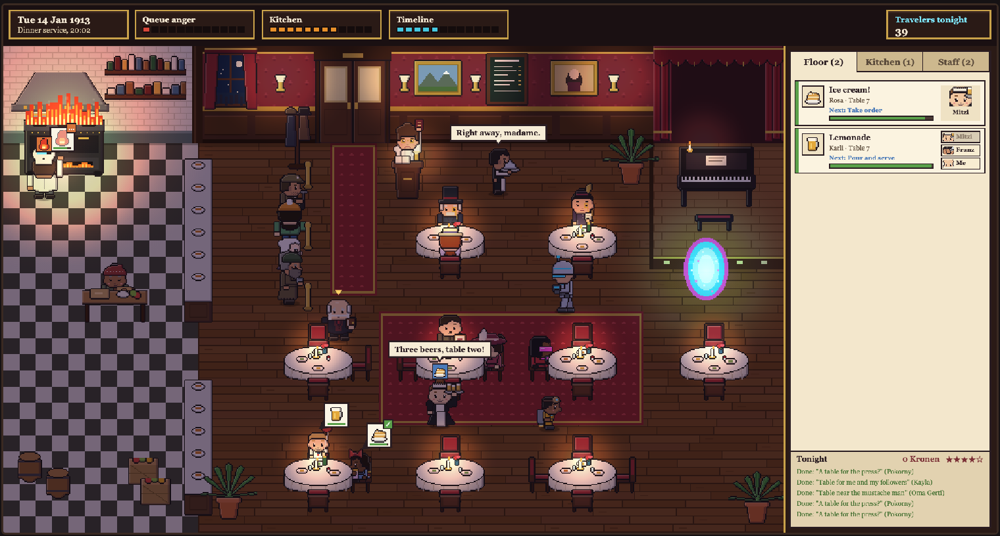
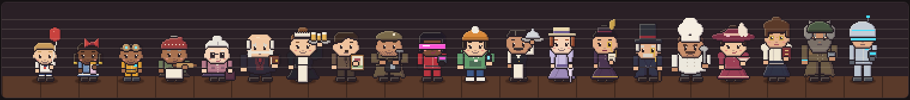
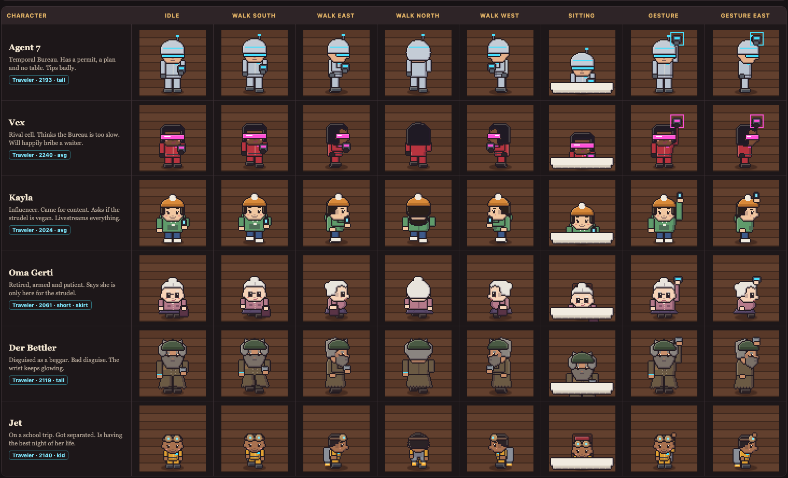

# Back to the Fuhrer

A pixel-art restaurant management game set in a Vienna restaurant on the night of 14 January 1913. You run the place. One of your regulars is a failed painter with a small mustache who wants one coffee and a quiet evening. Tonight, people from the future keep stepping out of a portal by the piano, and they are all here to kill him.

## The restaurant

At its core this is a management game. You keep a busy dining room running through one long night.

- **Front desk.** Guests wait in a queue at the door. The host seats them, and queue anger grows if the line stalls.
- **Tables.** Seated guests raise requests as icons over their heads. They want drinks, food, coffee, dessert, forks or the check. Some requests are trouble, like a fly in the soup or a kitchen fire.
- **Kitchen.** The chef and the pastry cook cook, brew and plate at their stations. The kitchen has its own load meter and can fall behind.
- **Staff.** Waiters take orders and serve. You assign floor tasks to a waiter or do them yourself. The kitchen and the front desk pick up their own work.
- **Patience.** Every request has a timer. Finished requests earn Kronen and reputation. Lost requests cost reputation, and losing a VIP costs more.
- **Problems only you can handle.** Some requests skip the staff and go straight to you. A traveler asks to sing on stage. A beggar is working the room. A guest looks suspicious.

The task panel on the right sorts every open request by urgency and splits them into Floor, Kitchen and Staff tabs. The top bar tracks the clock, queue anger, kitchen load, the timeline and how many travelers have arrived tonight.

## The other job

You are also the contact for the time travelers. Officially they are guests. Unofficially they need someone on the inside, and that someone is you. Over the night you have to:

1. **Spot the assassins.** Travelers mix in with the regular 1913 crowd. Some are obvious, some are disguised, and some are just tourists. Work out who is actually here for the target.
2. **Confirm the target.** Make contact with the assassins and agree on which guest is Hitler. It should be easy, since he has the mustache. It never is.
3. **Keep the plot hidden.** Your staff, the other guests, a colonel who thinks every traveler is a spy, a food critic and a newspaper photographer are all in the room. None of them can find out what is going on.
4. **Give the assassins what they need.** A table near the target, the right dish, a distraction at the right moment. You supply it while the rest of the restaurant keeps running.
5. **Clean up the failed attempts.** The attempts go wrong. When they do, you cover the mess before the room panics, the critic writes it up or the timeline meter tips over.

The restaurant and the mission pull against each other. Every minute spent helping an assassin is a minute your tables wait. Every guest you keep happy is one less witness to an attempt.

## Characters

Everything is drawn by code at 64x64 pixels per character, with idle, four walk directions, sitting and gesture poses.

The cast has your staff (a host, two waiters, a chef and a pastry cook), the 1913 regulars (a countess, an art student, a retired colonel, two kids, the critic, the photographer and Herr A. at table four) and the travelers.

- **Agent 7**, from the Temporal Bureau in 2193. Has a permit, a plan and no table.
- **Vex**, from a rival cell in 2240. Thinks the Bureau is too slow. Will bribe a waiter.
- **Kayla**, an influencer from 2024. Came for content and livestreams everything.
- **Oma Gerti**, from 2061. Retired, armed and patient. Says she is only here for the strudel.
- **Der Bettler**, from 2119. Disguised as a beggar. His wrist keeps glowing.
- **Jet**, from 2140. Got separated from a school trip.

## Status

The game is in early development. The art is approved. The restaurant mechanics are partly built in the art lab, which already runs the request system, the task panel, staff dispatch, the queue, the kitchen stations and the portal. The assassin mechanics are still being designed. Art fixes waiting for later are listed in [BACKLOG.md](BACKLOG.md).

## Run the art lab

Open `art-lab/index.html` in a browser. No build step or server needed.

- `WASD` or arrow keys to walk, `Space` to gesture, `E` to handle the nearest request or sit.
- Click a character or a task for details.
- Use the bar above the room to pause, change speed, toggle night lighting, open a portal or switch who you play as.
- Add `?sim=45` to the URL to fast-forward the night by 45 seconds, or `?tab=kitchen` to open a panel tab.

`art-styles/` holds the reference images and the earlier style experiments. `idea.jpeg` is the original concept.
